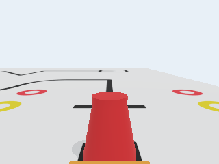

# 月光杯 · 仿真练习台

在车体结构完成前，用可配置的虚拟差速小车获取摄像头、红外、超声波和编码器数据，编写自己的视觉与控制程序。采用 **Webots R2025a＋Python**，面向月光杯参赛会员。


## 开始使用

1. 安装 [Webots R2025a](https://github.com/cyberbotics/webots/releases/tag/R2025a) 和 [Python 3.11～3.13](https://www.python.org/downloads/)。安装 Python 时选择加入 PATH。
2. [下载 v0.5.0 ZIP](https://github.com/3393350798/yueguang-cup-simulator/releases/download/v0.5.0/yueguang-cup-simulator-v0.5.0.zip) 并解压。在 Windows 下，双击 `setup.bat`，等待 Python 环境与依赖安装完毕，再关闭窗口。
3. 双击 `start.bat`，等待 Webots 加载赛场，脚本会自动打开中文浏览器面板。
4. 可先使用「手动探索」查看场景和传感器；编写程序后选择「会员算法」，点击「重载算法」和「开始运行」。

从旧版本升级时，先重新运行 `setup.bat` 安装模型导入依赖。需要导入 STEP 时，再双击 `scripts/setup-cad.bat` 安装转换组件。需要执行 STM32 固件时，运行 `scripts/setup-firmware.bat` 安装 Renode 后端，再通过 `scripts/import-hardware.bat` 的固件页导入程序并绑定引脚。

启动前关闭旧的同项目 Webots 窗口。Webots 和浏览器需要同时保持打开。项目支持中文目录，Windows 启动脚本会从安装信息或 `WEBOTS_HOME` 查找 Webots。自定义安装位置可在项目目录执行：

```powershell
powershell -ExecutionPolicy Bypass -File scripts/launch.ps1 -WebotsHome "D:\Webots"
```

浏览器面板地址：`http://127.0.0.1:1234/robot_windows/moonlight/moonlight.html?name=Moonlight`。运行期间使用的 Python 由启动脚本通过 `YUEGUANG_PYTHON` 指定，指向项目 `.venv`。

Linux/macOS 的启动入口：

```sh
python3 -m venv .venv
.venv/bin/python -m pip install -r requirements/core.txt
sh start.sh
```

`webots` 需已加入 PATH。启动后在浏览器打开终端显示的面板地址。Windows 已实测，Linux/macOS 入口待对应系统验证。Webots 需要可用的 OpenGL 图形环境，Windows 安装包约 251 MB。

## 功能

- **自定义小车**：在 `scripts/import-hardware.bat` 中调整底盘、车轮与仿真步长，并在坐标图中摆放红外、超声波和相机。也可用 `scripts/configure.bat` 直接编辑参数，详见 [自定义小车](docs/自定义小车.md)。
- **机械模型导入**：双击 `scripts/import-hardware.bat`，导入 URDF/ZIP 装配包并绑定左右轮，也可导入 STEP/STL/OBJ 底盘几何。额外关节可在面板手动设置目标位置，或由自己的程序控制，详见 [导入自己的硬件](docs/导入自己的硬件.md)。
- **嘉立创EDA资料导入**：导入标准版或专业版导出的 PADS 9.5 网表，查看器件和网络，在 STM32F103C8T6 封装图中选脚并连接设备；板卡 STEP/STL 可放到车上。
- **STM32 固件执行**：Renode 执行自己的 ELF/AXF/HEX/BIN，支持 PWM、AB 编码器、红外 ADC1 扫描及 DMA、超声波回波、USART 及简化夹爪。通过 HAL 和标准外设库样件验证的功能、时钟配置和范围见 [固件执行](docs/固件执行.md)。
- **调试与联调**：录制、导出和回放 PWM、轮速、编码器、红外、超声波、串口；向本机电脑程序提供无损相机帧和双向二进制串口。可调电机、传感器、灯光和通讯扰动，见 [调试与联调](docs/调试与联调.md)。
- **队伍项目**：在 `scripts/team-project.bat` 将当前小车、接线、固件与自编程序保存为本地 ZIP，也可从 ZIP 创建独立练习目录，见 [队伍项目](docs/队伍项目.md)。
- **手动探索**：按住面板方向按钮驾驶，松开停车；也可在 Webots 画面中使用 W/A/S/D，E 夹取或释放，空格停车。
- **会员算法入口**：编辑 `simulator/controllers/moonlight/member_algorithm.py` 中的 `vision()` 和 `step()`；保存后点「重载算法」。模板默认停车。
- **原始输入**：BGR 摄像头图像、红外、超声波、左右轮编码器与实测轮速。分辨率、传感器数量和安装位置可配置，默认 320×240、七路红外、前/左/右超声波。
- **执行器**：左右轮目标线速度，以及简化夹取/释放命令。
- **练习面板**：地图与轨迹、原始摄像头图像、传感器数值、组号与物块颜色重置、图片保存、通道入口定位。
- **任务记录**：抓取、放置圈及中心偏差、通道接触、终点停稳与摆正状态。

组号偶数对应 AprilTag ID 0 和左侧目标（地图下排），奇数对应 ID 1 和右侧目标（上排）。物块为红、黄、蓝三种颜色，每轮一个，选择后重置生效。

控制、视觉识别和完整任务策略由会员自行实现。公开包提供空白接口和仿真运行环境。

## 操作与练习

在面板修改组号与物块颜色后，点击「重置场景」使设置生效。Webots 仿真时间持续推进；「开始运行」和「暂停 / 停车」控制车辆及会员程序。调整小车尺寸、传感器或导入硬件后，关闭 Webots 再重新启动，详细字段见下方的配置文档。

车头橙色结构代表简化夹爪。手动接近物块后点击「夹取」，到放置位置后点击「释放」。面板记录抓取状态、放置圈和中心偏差。点击「放到超声波区域入口」可将小车放到通道右侧入口、车头朝左，便于查看无线路段的测距数据。

点击「保存原图」，项目 `simulator/output/` 目录会生成 PNG，尺寸与 `simulator/robot.json` 中的摄像头分辨率一致。电脑视觉程序可直接读取；OpenMV 队伍可将图片复制到真实板卡，按其固件支持的格式加载。画面包含标签、物块、地面色圈和其他环境内容。

任务面板显示放置侧别、颜色、位置偏差和通道接触记录。车轮与支撑点进入终点内框、连续静止 3 秒后显示停稳；底盘投影位于内框内、角度偏差不超过 10° 时显示摆正。这些是练习判据，正式计分以赛事统一规定为准。

## 场景与模型


- 最终赛事布局的教学近似赛场：右侧曲线、顶部分类放置、中部圆弧、下部超声波区域、左侧折线与终点。
- 默认差速小车：底盘长 150 mm，含轮宽约 139 mm；轮径 54 mm，轮距 125 mm，可由 `simulator/robot.json` 调整。
- 黑线宽 22.5 mm，六个对称圆圈，外径 87.5 mm、内径 42.5 mm。
- 超声波区内部留白，设置两侧实体挡板与出口检测线。
- 练习标签为 tag36h11，黑色码区边长 80 mm，含白边牌面 100 mm。
- 物块依据赛题图2建模：底径 56 mm、顶径 36 mm、总高 70 mm，底座高 8 mm、上颈高 10 mm，中间为高 52 mm 的锥台；红黄蓝使用同一外形。视觉与碰撞体均采用对应轮廓，夹取到位后附着，释放后恢复地面位置。质量暂设 40 g，赛题未给出实测质量。

场地精确几何、挡板、标签和精准放置判据可按正式 DWG 与统一口径更新。面板记录动作与偏差，正式分值以赛事规定为准。轮速接口采用一阶执行器响应。固件模式将PWM占空比折算为电机目标速度，并将实际轮角反馈给MCU，可以练习速度环逻辑；真实电机死区、电气动力学和PID数值仍需实车标定。



电脑视觉队伍可在 `vision()` 中处理图像，通过 `uart_tx` 返回串口文字或字节；独立电脑程序也可使用本机接口。OpenMV 队伍可在真实板卡上回放保存的图像。实体 STM32、手机串流和无线串口的设备接入由各队按实际方案配置。

## 文件与说明

- [算法接口](docs/算法接口.md)：字段、单位、调用方式与输出协议。
- [自定义小车](docs/自定义小车.md)：硬件字段、安装坐标与生效方式。
- [导入自己的硬件](docs/导入自己的硬件.md)：SolidWorks导出、URDF关节绑定、STEP底盘和嘉立创EDA网表。
- [固件执行](docs/固件执行.md)：STM32F103C8T6程序导入、接线、串口视觉、时钟与外设模型范围。
- [调试与联调](docs/调试与联调.md)：波形回放、电脑视觉与串口、可控扰动参数。
- [队伍项目](docs/队伍项目.md)：导出本地 ZIP，恢复到独立项目。
| 入口或目录 | 内容 |
| --- | --- |
| `setup.bat`、`start.bat` | Windows 安装依赖与启动仿真；Linux/macOS 使用 `start.sh` |
| `scripts/` | 配置小车、导入硬件、安装 STEP 和固件后端的入口 |
| `docs/` | 接口、硬件和固件说明及截图 |
| `requirements/` | Python 基础依赖 `core.txt` 和可选 STEP 依赖 `cad.txt` |
| `simulator/` | Webots 工程：`controllers/` 控制器、`worlds/` 世界、`plugins/` 面板、`tools/` 桥接与生成工具、`hardware/` 格式示例 |

小车、板卡、固件配置分别为 `simulator/robot.json`、`simulator/board.json`、`simulator/firmware.json`；`simulator/scene.json` 是生成的场景参数。会员从 `simulator/controllers/moonlight/member_algorithm.py` 编写自己的程序。

从 v0.4.0 或更早版本升级时，将原有 `robot.json`、`board.json`、`firmware.json` 和自己使用的 `hardware/imported/`、`protos/imported/` 放入新包的 `simulator/`，保持它们之间的相对路径；自己的算法文件放入 `simulator/controllers/moonlight/`。保存原包后再迁移。

代码与原创教学资源按 MIT 发布。外部依赖和官方文档链接见 [依赖与参考](docs/THIRD_PARTY.md)。
