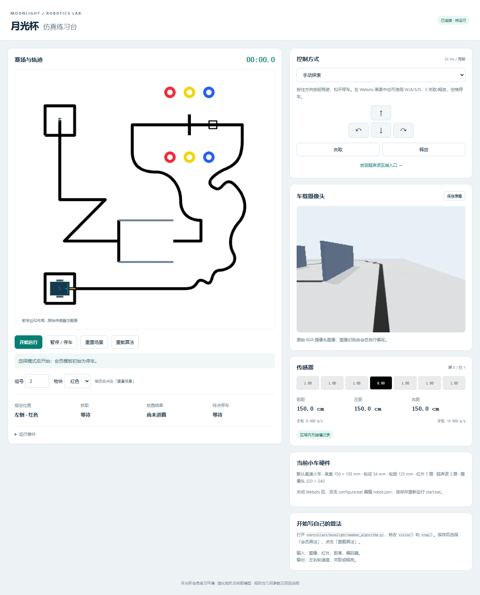
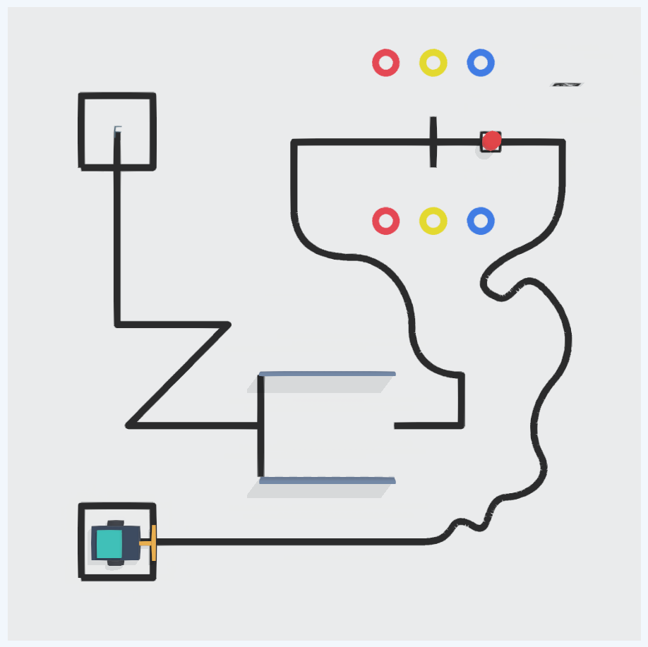

# 月光杯 · 仿真练习台

在车体结构完成前，用可配置的虚拟差速小车获取摄像头、红外、超声波和编码器数据，编写自己的视觉与控制程序。采用 **Webots R2025a＋Python**，面向月光杯参赛会员。



## 开始使用

1. 安装 [Webots R2025a](https://github.com/cyberbotics/webots/releases/tag/R2025a) 和 [Python 3.11～3.13](https://www.python.org/downloads/)。安装 Python 时选择加入 PATH。
2. [下载 v0.2.0 ZIP](https://github.com/3393350798/yueguang-cup-simulator/releases/download/v0.2.0/yueguang-cup-simulator-v0.2.0.zip) 并解压。在 Windows 下，双击 `setup.bat`，等待 Python 环境与依赖安装完毕，再关闭窗口。
3. 双击 `start.bat`，等待 Webots 加载赛场，脚本会自动打开中文浏览器面板。
4. 可先使用「手动探索」查看场景和传感器；编写程序后选择「会员算法」，点击「重载算法」和「开始运行」。

从 v0.1.0 升级时，先重新运行 `setup.bat`，安装启动时生成车模所需的 Pillow。

启动前关闭旧的同项目 Webots 窗口。Webots 和浏览器需要同时保持打开。项目支持中文目录，Windows 启动脚本会从安装信息或 `WEBOTS_HOME` 查找 Webots。自定义安装位置可在项目目录执行：

```powershell
powershell -ExecutionPolicy Bypass -File tools/launch.ps1 -WebotsHome "D:\Webots"
```

浏览器面板地址：`http://127.0.0.1:1234/robot_windows/moonlight/moonlight.html?name=Moonlight`。运行期间使用的 Python 由启动脚本通过 `YUEGUANG_PYTHON` 指定，指向项目 `.venv`。

Linux/macOS 的启动入口：

```sh
python3 -m venv .venv
.venv/bin/python -m pip install -r requirements.txt
sh start.sh
```

`webots` 需已加入 PATH。启动后在浏览器打开终端显示的面板地址。Windows 已实测，Linux/macOS 入口待对应系统验证。Webots 需要可用的 OpenGL 图形环境，Windows 安装包约 251 MB。

## 功能

- **自定义小车**：双击 `configure.bat` 编辑 `robot.json`，调整底盘、车轮、电机、摄像头、红外、超声波和简化夹爪。重新启动后生成对应车模，详见 [自定义小车](docs/自定义小车.md)。
- **手动探索**：按住面板方向按钮驾驶，松开停车；也可在 Webots 画面中使用 W/A/S/D，E 夹取或释放，空格停车。
- **会员算法入口**：编辑 `controllers/moonlight/member_algorithm.py` 中的 `vision()` 和 `step()`；保存后点「重载算法」。模板默认停车。
- **原始输入**：BGR 摄像头图像、红外、超声波、左右轮编码器与实测轮速。分辨率、传感器数量和安装位置可配置，默认 320×240、七路红外、前/左/右超声波。
- **执行器**：左右轮目标线速度，以及简化夹取/释放命令。
- **练习面板**：地图与轨迹、原始摄像头图像、传感器数值、组号与物块颜色重置、图片保存、通道入口定位。
- **任务记录**：抓取、放置圈及中心偏差、通道接触、终点停稳与摆正状态。

组号偶数对应 AprilTag ID 0 和左侧目标（地图下排），奇数对应 ID 1 和右侧目标（上排）。物块为红、黄、蓝三种颜色，每轮一个，选择后重置生效。

控制、视觉识别和完整任务策略由会员自行实现。公开包提供空白接口和仿真运行环境。

## 场景与模型



- 最终赛事布局的教学近似赛场：右侧曲线、顶部分类放置、中部圆弧、下部超声波区域、左侧折线与终点。
- 默认差速小车：底盘长 150 mm，含轮宽约 139 mm；轮径 54 mm，轮距 125 mm，可由 `robot.json` 调整。
- 黑线宽 22.5 mm，六个对称圆圈，外径 87.5 mm、内径 42.5 mm。
- 超声波区内部留白，设置两侧实体挡板与出口检测线。
- 练习标签为 tag36h11，黑色码区边长 80 mm，含白边牌面 100 mm。
- 物块为直径 56 mm、高 70 mm 的简化圆柱；夹取到位后附着，释放后恢复地面位置。

场地精确几何、挡板、标签和精准放置判据可按正式 DWG 与统一口径更新。面板记录动作与偏差，正式分值以赛事规定为准。轮速接口采用一阶执行器响应，适合行驶外环和任务流程练习；真实 PWM 驱动、速度环、电机死区和机械参数需要在实车中接入与标定。

电脑视觉队伍可在 `vision()` 中接入自己的处理程序；OpenMV 队伍可保存原图，在真实板卡中读取处理。STM32、手机串流和无线串口的专用接入需结合各队设备完成。

## 文件与说明

- [算法接口](docs/算法接口.md)：字段、单位、调用方式与输出协议。
- [会员使用指南](docs/会员练习指南.md)：操作与图片导出。
- [自定义小车](docs/自定义小车.md)：硬件字段、安装坐标与生效方式。
- `worlds/`：世界与纹理；`scene.json`：场景参数。
- `controllers/moonlight/`：平台桥接与会员空白接口。
- `plugins/robot_windows/`：中文练习面板。
- `robot.json`：会员小车配置；`tools/build_scene.py`：启动时据此生成模型与场景资源。

代码与原创教学资源按 MIT 发布。外部依赖和官方文档链接见 [THIRD_PARTY.md](THIRD_PARTY.md)。
