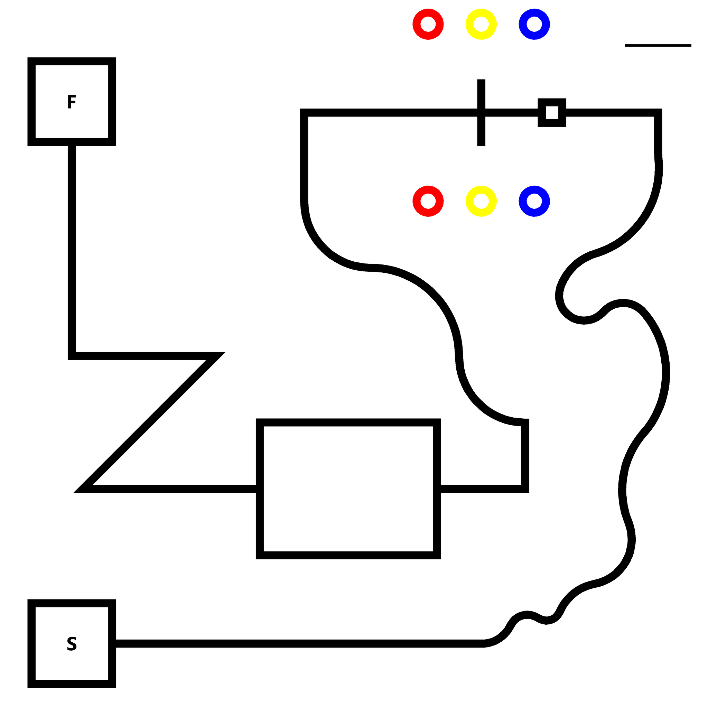

# 月光杯 · 仿真练习台

在车体结构完成前，用可配置的虚拟差速小车获取摄像头、红外、超声波和编码器数据，编写自己的视觉与控制程序。采用 **Webots R2025a＋Python**，面向月光杯参赛会员。


## 开始使用

1. 安装 [Webots R2025a](https://github.com/cyberbotics/webots/releases/tag/R2025a) 和 [Python 3.11～3.13](https://www.python.org/downloads/)。安装 Python 时选择加入 PATH。
2. [下载 v0.15.0 ZIP](https://github.com/3393350798/yueguang-cup-simulator/releases/download/v0.15.0/yueguang-cup-simulator-v0.15.0.zip) 并解压。在 Windows 下，双击 `launcher.bat`，从菜单安装项目依赖。
3. 从同一菜单启动练习，等待 Webots 和控制器就绪。已经装好依赖时，也可双击 `start.bat` 直接启动。
4. 可先使用「手动探索」查看场景和传感器；编写程序后选择「会员算法」，点击「重载算法」和「开始运行」。

已有旧队伍工程时，先把新版解压到单独目录，再从新版运行 `scripts/upgrade-project.bat`，预览并迁移到新目录。见 [项目升级](docs/项目升级.md)。需要导入 STEP 时，双击 `scripts/setup-cad.bat` 安装转换组件；需要执行 STM32 固件时，运行 `scripts/setup-firmware.bat` 安装 Renode 后端。

启动遇到问题时，打开 `launcher.bat` 按队伍接入方式运行[启动自检](docs/启动自检.md)。启动会分别检查依赖、Webots 进程、网页和控制器；面板打不开也能从菜单导出诊断。
实体 STM32 串口联调遇到问题时，运行 `scripts/check-serial.bat`，见[实车串口自检](docs/实车串口自检.md)。首次走通视觉到 STM32 的链路时，按[真机验收](docs/真机验收.md)记录各环节，再用[实车录制与联调](docs/实车录制与联调.md)定位故障。
练习中某一轮出问题时，先记录结果，再从该行导出[本轮求助包](docs/求助包.md)。如果面板打不开，也可双击 `scripts/export-diagnostics.bat` 导出[故障诊断](docs/故障诊断.md)，和你遇到的现象一起发给负责人。

启动前关闭旧的同项目 Webots 窗口。Webots 和浏览器需要同时保持打开。项目支持中文目录，Windows 启动脚本会从安装信息或 `WEBOTS_HOME` 查找 Webots。自定义安装位置可在项目目录执行：

```powershell
powershell -ExecutionPolicy Bypass -File scripts/launch.ps1 -WebotsHome "D:\Webots"
```

浏览器面板地址：`http://127.0.0.1:1234/robot_windows/moonlight/moonlight.html?name=Moonlight`。运行期间使用的 Python 由启动脚本通过 `YUEGUANG_PYTHON` 指定，指向项目 `.venv`。

Linux/macOS 的启动入口：

```sh
python3 -m venv .venv
.venv/bin/python -m pip install -r requirements/core.txt
sh start.sh
```

`webots` 需已加入 PATH。启动后在浏览器打开终端显示的面板地址。Windows 已实测，Linux/macOS 入口待对应系统验证。Webots 需要可用的 OpenGL 图形环境，Windows 安装包约 251 MB。

## 功能

- **自定义小车**：在 `scripts/import-hardware.bat` 中调整底盘、车轮与仿真步长，并在坐标图中摆放红外、超声波和相机。也可用 `scripts/configure.bat` 直接编辑参数，详见 [自定义小车](docs/自定义小车.md)。
- **机械模型导入**：双击 `scripts/import-hardware.bat`，导入 URDF/ZIP 装配包并绑定左右轮，也可导入 STEP/STL/OBJ 底盘几何。额外关节可在面板手动设置目标位置，或由自己的程序控制，详见 [导入自己的硬件](docs/导入自己的硬件.md)。
- **装配体检**：双击 `scripts/assembly-check.bat`，在独立场景检查轮向、传感器视野和夹爪动作；可以比较不同相机位置和俯仰角下的遮挡。新版发行包的默认车采用重新验证过的相机位置，迁移旧工程时保留队伍自己的设置。见 [装配体检](docs/装配体检.md)。
- **嘉立创EDA资料导入**：导入标准版或专业版导出的 PADS 9.5 网表，查看器件和网络，在 STM32F103C8T6 封装图中选脚并连接设备；板卡 STEP/STL 可放到车上。
- **STM32 固件执行**：Renode 执行自己的 ELF/AXF/HEX/BIN，支持 PWM、AB 编码器、红外 ADC1 扫描及 DMA、超声波回波、USART 和夹爪开合、升降信号。通过 HAL 和标准外设库样件验证的功能、时钟配置和范围见 [固件执行](docs/固件执行.md)。
- **STM32 外设测试台**：双击 `scripts/firmware-bench.bat`，给自己的固件输入已知的传感器信号或队伍协议帧，观察实际输出。见 [固件测试台](docs/固件测试台.md)。
- **调试与联调**：录制、导出和回放 PWM、轮速、编码器、红外、超声波、串口；向本机电脑程序提供无损相机帧和双向二进制串口。可调电机、传感器、灯光和通讯扰动，见 [调试与联调](docs/调试与联调.md)。
- **视觉样本回放**：双击 `scripts/vision-replay.bat`，用同一组场景原图和正确标签检验自己的识别结果。见 [视觉样本回放](docs/视觉样本回放.md)。
- **视觉连续帧回放**：双击 `scripts/vision-sequence.bat`，把同一组图像按正常、掉帧、停帧和恢复的时间表送给自己的程序，或主动录制几秒 Webots 原图，在队伍自己的难例上对照两版视觉程序。见 [视觉连续帧回放](docs/视觉连续帧回放.md)。
- **视觉和固件联测**：双击 `scripts/vision-firmware.bat`，把电脑视觉程序或 OpenMV 记录的串口数据按同一时间表送给虚拟 STM32，比较两版固件的回包和 PWM；也可同步重放仿真的红外、超声波和编码器输入。新版片段会在回放前核对录制时实际使用的引脚、USART 和编码器计数等设置。见 [视觉固件联测](docs/视觉固件联测.md)。
- **失败回放**：回看碰撞、意外掉块和程序错误前后的位姿、夹爪状态与波形。计时练习到时仍未完成时，也会保留到时前约 5 秒的回放。见 [失败回放](docs/失败回放.md)。
- **夹爪测试台**：用同一组物块偏移、角度和摩擦对照夹爪设计，见 [夹爪测试台](docs/夹爪测试台.md)。
- **队伍项目**：在 `scripts/team-project.bat` 将当前小车、接线、固件与自编程序保存为本地 ZIP，也可从 ZIP 创建独立练习目录，见 [队伍项目](docs/队伍项目.md)。
- **队伍工程升级**：在新版运行 `scripts/upgrade-project.bat`，预览要迁移的数据及本机依赖，在独立目录创建新版工程，见 [项目升级](docs/项目升级.md)。
- **手动探索**：按住面板方向按钮驾驶，松开停车；也可在 Webots 画面中使用 W/A/S/D 驾驶、E 切换夹爪开合、Q 切换升降、空格停车。
- **会员算法入口**：编辑 `simulator/controllers/moonlight/member_algorithm.py` 中的 `vision()` 和 `step()`；保存后点「重载算法」。模板默认停车。
- **原始输入**：BGR 摄像头图像、红外、超声波、左右轮编码器与实测轮速。分辨率、传感器数量和安装位置可配置，默认 320×240、七路红外、前/左/右超声波。
- **物理夹爪**：利用爪指和物块碰撞、关节动作与摩擦完成抓取。可调整双指夹爪参数，或用 URDF 装配体中的真实夹爪关节和碰撞体验证自己的设计。
- **练习面板**：地图与轨迹、原始摄像头图像、传感器数值、组号与物块颜色重置、图片保存、通道入口定位。
- **分赛段练习**：一键从抓放、通道或停车入口开始。支持同条件多轮练习，以及组号奇偶 × 红黄蓝的六种固定工况；可导出结果并与历史对照。练习历史按工程保存在当前浏览器，可在刷新后找回以往轮次与可用回放，也可用当前程序只复跑选中的一轮，与原结果对照。见 [分赛段练习](docs/分赛段练习.md)。
- **故障工况回归**：在固定工况中重现指定时段的超声波无回波或仿真串口故障，按工况查看改动前后的结果，见 [故障工况回归](docs/故障工况回归.md)。
- **赛场容差回归**：在分赛段练习中重复测试起点偏移、物块摆放偏移和光照变化，查看各工况通过情况及首个未通过项，并导入旧报告逐项核对同条件下的变化。预设用于练习，见 [赛场容差回归](docs/赛场容差回归.md)。
- **标定与实车迁移**：用实测电机、测距、红外和编码器数据校准虚拟小车；电脑端使用相同的字节接口切换本机仿真串口和真实 COM 口，见 [标定与实车迁移](docs/标定与实车迁移.md)。
- **实车波形对照**：打开 `scripts/telemetry-compare.bat`，将实车 CSV 与仿真波形按动作时刻对齐，比较电机和传感器读数，见 [实车波形对照](docs/实车波形对照.md)。
- **实车录制与时间线**：打开 `scripts/telemetry-record.bat`，整理队伍日志，查看视觉与串口事件的时间线，导出波形工具可读的 CSV，见 [实车录制与联调](docs/实车录制与联调.md)。
- **真机验收**：用 `scripts/field-acceptance.bat` 核对取帧、识别、串口收发和实际运动的记录。支持 OpenMV 直连和手机串流经电脑及无线串口两种方案，见 [真机验收](docs/真机验收.md)。

组号偶数对应 AprilTag ID 0 和左侧目标（地图下排），奇数对应 ID 1 和右侧目标（上排）。物块为红、黄、蓝三种颜色，每轮一个，选择后重置生效。

控制、视觉识别和完整任务策略由会员自行实现。公开包提供空白接口和仿真运行环境。

## 操作与练习

在面板修改组号与物块颜色后，点击「重置场景」使设置生效。Webots 仿真时间持续推进；「开始运行」和「暂停 / 停车」控制车辆及会员程序。调整小车尺寸、传感器或导入硬件后，关闭 Webots 再重新启动，详细字段见下方的配置文档。

手动把爪指对准物块，点击「合拢夹爪」，观察两侧接触，再点击「抬升夹爪」检查是否离地。放置时可先降下，再张开；物块自由下落或落地后停稳，面板按实际位置判定放置圈和中心偏差。点击「放到超声波区域入口」可将小车放到通道右侧入口、车头朝左，便于查看无线路段的测距数据。

点击「保存原图」，项目 `simulator/output/` 目录会生成 PNG，尺寸与 `simulator/robot.json` 中的摄像头分辨率一致。电脑视觉程序可直接读取；OpenMV 队伍可将图片复制到真实板卡，按其固件支持的格式加载。画面包含标签、物块、地面色圈和其他环境内容。

任务面板显示放置侧别、颜色、位置偏差和通道接触记录。车轮与支撑点进入终点内框、连续静止 3 秒后显示停稳；底盘投影位于内框内、角度偏差不超过 10° 时显示摆正。这些是练习判据，正式计分以赛事统一规定为准。

## 场景与模型



- 地面图形来自 2000 × 2000 mm「赛规定尺版」DWG；起点和终点外框 250 × 250 mm、内框 205 × 205 mm。拾取框外边长 80 mm。
- 默认差速小车：底盘长 150 mm，含轮宽约 139 mm；轮径 54 mm，轮距 125 mm，可由 `simulator/robot.json` 调整。
- 黑线宽 22.5 mm，六个对称圆圈，外径 87.5 mm、内径 42.5 mm。
- 超声波区只保留 500 × 375 mm 的黑框（按边线中心距），区内没有文字和贯穿循迹线。两块实体挡板各长 500 mm，沿黑框长边中心线布置，两端对齐短边中心线。通道两端开放。
- 立牌放在印布右上角的定位横条上；练习标签为 tag36h11，黑色码区边长 80 mm，含白边牌面 100 mm。
- 物块依据赛题图2建模：底径 56 mm、顶径 36 mm、总高 70 mm，底座高 8 mm、上颈高 10 mm，中间为高 52 mm 的锥台；红黄蓝使用同一外形。物块始终参与 Webots 物理碰撞，可能滑落、移位或翻倒。质量暂设 40 g，实物称重后可自行修改。

地面纹理和摆位由 `simulator/assets/competition_field.json` 统一生成；该文件保留以毫米绘制的轮廓与布局坐标。实体牌面姿态、挡板厚度与高度、出口判据及精准放置要求以赛事公布为准。轮速接口采用一阶执行器响应。固件模式将 PWM 占空比折算为电机目标速度，并将实际轮角反馈给 MCU，可以练习速度环；真实电机死区、电气动力学和 PID 参数仍需实车标定。


电脑视觉队伍可在 `vision()` 中处理图像，通过 `uart_tx` 返回串口文字或字节；独立电脑程序也可使用本机接口。OpenMV 队伍可在真实板卡上回放保存的图像。实体 STM32、手机串流和无线串口的设备接入由各队按实际方案配置。

## 文件与说明

- [算法接口](docs/算法接口.md)：字段、单位、调用方式与输出协议。
- [自定义小车](docs/自定义小车.md)：硬件字段、安装坐标与生效方式。
- [导入自己的硬件](docs/导入自己的硬件.md)：SolidWorks导出、URDF关节绑定、STEP底盘和嘉立创EDA网表。
- [固件执行](docs/固件执行.md)：STM32F103C8T6程序导入、接线、串口视觉、时钟与外设模型范围。
- [固件测试台](docs/固件测试台.md)：不跑赛道，用已知输入检查固件的外设输出。
- [调试与联调](docs/调试与联调.md)：波形回放、电脑视觉与串口、可控扰动参数。
- [视觉样本回放](docs/视觉样本回放.md)：场景原图、标签、板端回放和结果对照。
- [视觉连续帧回放](docs/视觉连续帧回放.md)：固定序列、队伍难例录制和两版视觉对照。
- [视觉固件联测](docs/视觉固件联测.md)：在同一串口及传感器输入下比较两版 STM32 固件。
- [队伍项目](docs/队伍项目.md)：导出本地 ZIP，恢复到独立项目。
- [项目升级](docs/项目升级.md)：保留旧工程，将自定义配置与程序迁移到新版。
- [分赛段练习](docs/分赛段练习.md)：赛段起点、多轮对照和判定范围。
- [本轮求助包](docs/求助包.md)：预览并导出指定轮次的练习结果与可选诊断。
- [启动自检](docs/启动自检.md)：检查 Webots、固件、引脚和本机联调接口。
- [标定与实车迁移](docs/标定与实车迁移.md)：拟合标定数据，切换仿真和实体串口。

| 入口或目录 | 内容 |
| --- | --- |
| `setup.bat`、`start.bat` | Windows 安装依赖与启动仿真；Linux/macOS 使用 `start.sh` |
| `scripts/` | 配置小车、导入硬件、安装 STEP 和固件后端的入口 |
| `docs/` | 接口、硬件和固件说明及截图 |
| `requirements/` | Python 基础依赖 `core.txt`，可选 STEP 依赖 `cad.txt` 和实车串口依赖 `serial.txt` |
| `simulator/` | Webots 工程：`controllers/` 控制器、`worlds/` 世界、`plugins/` 面板、`tools/` 桥接与生成工具、`hardware/` 格式示例 |

小车、板卡、固件配置分别为 `simulator/robot.json`、`simulator/board.json`、`simulator/firmware.json`；`simulator/scene.json` 是生成的场景参数。会员从 `simulator/controllers/moonlight/member_algorithm.py` 编写自己的程序。

从 v0.4.0 或更早版本升级时，先按 [项目升级](docs/项目升级.md) 核对项目布局和需要手工处理的文件，保留旧工程供对照。

从旧版迁移抓取程序时，原有 `grab` 或 `gripper_close` 只会合爪。另使用 `gripper_lift` 控制升降，检查夹爪能否夹紧并抬起物块。旧硬件配置未指定夹爪时，参数车模使用默认夹爪，URDF 车模需要在硬件窗口绑定自己的夹爪关节与碰撞体。

代码与原创教学资源按 MIT 发布。外部依赖和官方文档链接见 [依赖与参考](docs/THIRD_PARTY.md)。
