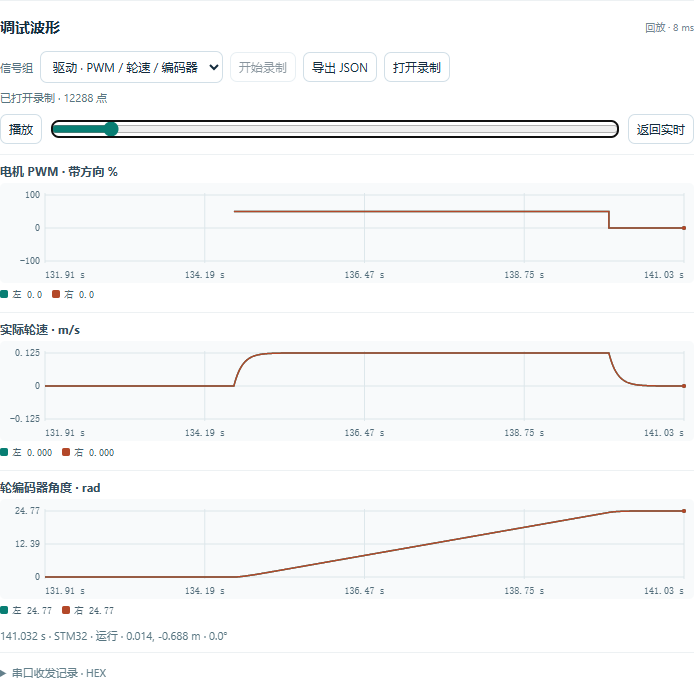

# 调试波形与视觉联调

## 记录一次运行

在练习面板查看「调试波形」。驱动组显示带方向的 PWM（固件模式）、实际轮速和轮角；环境组显示各路红外和超声波距离。曲线使用同一仿真时间，串口区以十六进制列出该采样周期的实际收发字节。面板约每 64 ms 仿真时间收到一批状态和样本。波形滚出可视区域时暂停绘制，录制仍保留每个机械周期的原始样本。网页相机每约 192 ms 刷新压缩预览，最长边不超过 480 像素；保存原图和本机视觉接口仍提供完整分辨率。



点击「开始录制」后操作小车，再停止并导出 JSON。打开录制文件可拖动进度查看各时刻的曲线、车体位置和串口数据；回放只显示历史信号。浏览器关闭前请导出要保留的录制。复位会结束正在进行的录制，保留已录数据。

通过硬件窗口或 `simulator/robot.json` 中的 `step_ms` 选 4、8、16、32 ms，保存后重启。默认 32 ms；周期越短，机械反馈越频繁，运行负载也越高。摄像头以 32 ms 采样，固件模式的内置 Python 视觉钩子以约 192 ms 调用。速度倍率 1× 表示仿真与实际时间进度接近。

## 外部电脑视觉与二进制串口

关闭 Webots，在硬件窗口填写本机联调端口，或将 `simulator/robot.json` 中的 `vision_link_port` 设为例如 `8765`，然后重新启动。值为 `0` 时关闭。服务监听 `127.0.0.1`，供同一台电脑上的 Python、C++ 等程序调用。

| 请求 | 行为 |
| --- | --- |
| `GET /frame.png` | 车载相机的最新无损 PNG，保留配置分辨率。每 64 ms 仿真时间更新，`X-Sim-Time` 为该帧的 Webots 时间（秒）。 |
| `POST /uart` | 请求体为原始字节，类型 `application/octet-stream`。每次 1～4096 字节；返回 204 表示已排队，409 表示当前未运行模拟固件，429 表示队列已满。 |
| `GET /uart?after=0` | 返回 MCU 写出的字节，从绝对字节位置 `after` 开始。下次传回响应头 `X-Next-Cursor`，避免重复读；`X-Buffer-Start` 超过请求位置表示较早字节已被滚动淘汰。 |

例如，用相同的电脑视觉程序读取虚拟相机或手机串流，处理后，将自己的编码结果发送给模拟 USART。把下例的 `payload` 替换为程序生成的字节。联调实物时可改用同一程序的无线串口传输。

```python
from urllib.request import Request, urlopen

base = "http://127.0.0.1:8765"
with urlopen(base + "/frame.png", timeout=3) as response:
    png = response.read()

payload = bytes([0x00, 0xFF, 0x53])
request = Request(base + "/uart", data=payload,
                  headers={"Content-Type": "application/octet-stream"})
with urlopen(request, timeout=3) as response:
    print(response.status)

with urlopen(base + "/uart?after=0", timeout=3) as response:
    uart_bytes = response.read()
    next_cursor = int(response.headers["X-Next-Cursor"])
```

面板也可手输 HEX，例如 `00 FF 53`，按原样发送。使用内置 `vision(image_bgr)` 时，可通过 `{'uart_tx': data}` 返回 UTF-8 文本、`bytes` 或字节值列表。OpenMV 队伍可保存原图，在真实 OpenMV 上回放；电脑接口不会执行 OpenMV 固件。

## 加入可控扰动

编辑 `simulator/robot.json` 的 `imperfections`，保存后重启。默认关闭各项扰动；可先单独开启一项，看处理结果和波形如何变化。

| 参数 | 作用 |
| --- | --- |
| `seed` | 随机种子；场景重置后重新开始抽样。对照时用相同起点、步骤和输入时序。 |
| `motor_gain` | 左、右电机的目标速度比例。例：`[1, 0.9]` 模拟右轮输出偏低。 |
| `motor_deadzone` | 左、右归一化死区，范围 0 至小于 1。死区内目标速度为零，以上重新映射至 0～1。 |
| `ir_noise` / `sonar_noise_mm` | 加在读数上的高斯噪声标准差，分别以红外归一化值和 mm 表示。 |
| `light_gain` | 灯光强度缩放，0～3，默认 1。 |
| `uart_delay_ms` / `uart_loss` | 对发送给 MCU 的数据按入队批延迟、按概率随机丢弃。延迟按 MCU 同步边界生效，丢包率 0～1。暂停时延迟计时冻结。 |

这些设置便于比较控制程序对设定扰动的反应。真实电机、传感器、无线串口和场地光照仍需从实物测量。
